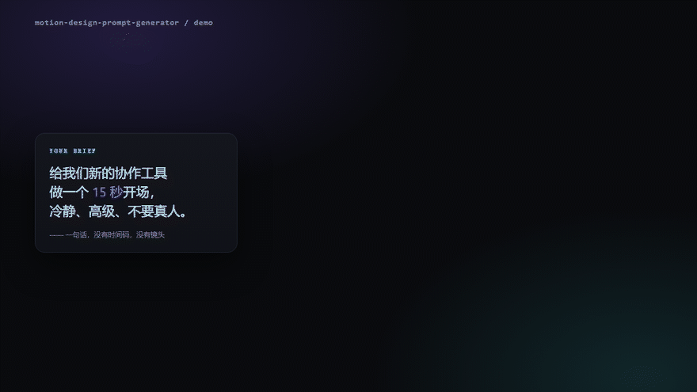

# Motion Design Prompt Generator

**Turn one line of intent into a frame-accurate motion spec** — beat sheet, lens, easing, duration — ready for Sora / Veo / Kling / Seedance / Runway.

一句话 → 帧级运动规格书。

[](LICENSE)
[](#deepseek-harness)
[](#claude-code)
[](README.zh.md)



Most AI-video prompts are piles of adjectives. This one is a specification.

## Install

### DeepSeek Harness

```powershell
# Windows — one line, no clone
git clone https://github.com/jhh266205-maker/motion-design-prompt-generator.git "$env:USERPROFILE\.dsh\skills\motion-design-prompt-generator"
```

```bash
# macOS / Linux
git clone https://github.com/jhh266205-maker/motion-design-prompt-generator.git ~/.dsh/skills/motion-design-prompt-generator
```

DSH watches the skills directory — no restart. Or install it as a plugin once it is on npm:

```bash
dsh plugin --profile web add dsh-skill-motion-design-prompt-generator
```

### Claude Code

```bash
git clone https://github.com/jhh266205-maker/motion-design-prompt-generator.git ~/.claude/skills/motion-design-prompt-generator
```

### Cursor / Codex / Windsurf

Clone into that client's skills root (`~/.cursor/skills/`, `~/.codex/skills/`, `~/.codeium/windsurf/skills/`), or into a project-level `.agents/skills/`.

### Any other agent

Drop `SKILL.md` wherever your agent looks for skills, or paste it into a system prompt — the whole method is self-contained in one file. `references/` and `assets/` are optional depth.

### One-command install (after cloning)

```powershell
powershell -NoProfile -ExecutionPolicy Bypass -File .\install.ps1   # Windows
```

```bash
./install.sh                 # macOS / Linux: DSH + Claude Code, whichever exists
./install.sh --target dsh    # DSH only
```

## Use it

The skill activates on intent; you never need to name it:

> Turn this brief into motion prompts: a matte-black cube that unfolds into a product page.

> I need a 9:16 Kling prompt for a logo reveal. Origami bird, 5 seconds.

> Give me a Remotion spec for a bar chart animation on a keynote screen.

> 把「一杯冰美式」做成 8 秒竖版动效提示词，要克制、别网红。

## What you get

| Output | Shape | Use |
|---|---|---|
| Master prompt | 80–160 words | Paste into Sora / Veo / Kling / Seedance |
| Beat sheet | Markdown table, time-coded | Editing, client review, shot planning |
| Platform variants | One rewrite per model | Same idea across models |
| Motion spec | JSON (schema included) | Remotion / HyperFrames / GSAP / Lottie |
| Negative + anchor block | Text | Fewer wasted takes, consistent subject |

## Why it works

Most prompts read like *"cinematic, stunning, smooth, high quality"* — a model can only answer that with the average of its training data, which is why the result looks like stock footage. This skill replaces adjectives with **observable facts**: lens, distance, duration, easing, angle, material, one physical detail, one negative constraint.

```
Before  a stunning cinematic animation, smooth motion, 4K, futuristic UI
After   100 mm macro, dolly-in 40 cm → 15 cm over 5 s, 24 fps, one take,
        panels overshoot 5° and lock, single cold key, no lens flare
```

## What's inside

```
SKILL.md                        # the method: 5-step workflow, 9-slot prompt anatomy, QA gate
references/motion-grammar.md    # easing curves, spring params, duration baselines, lens/transition vocabulary
references/platform-presets.md  # prompt skeletons + failure modes for 6 platforms
references/examples.md          # 4 worked cases: product film, logo reveal, kinetic type, data viz
assets/prompt-card.md           # delivery template
assets/spec.schema.json         # JSON Schema for code-based motion specs
assets/demo.html                # the animation behind the GIF (open it, edit it)
```

## Design principles

1. **No adjectives without a measurement.** "Cinematic lighting" becomes `single hard key from camera-left, 45°, deep falloff, no fill`.
2. **One motion event every 2 seconds.** Stillness is a tool, not an accident.
3. **Negative constraints are part of the prompt.** What must not appear matters as much as what must.
4. **Consistency needs an anchor.** Every subject gets a fixed description block reused verbatim across shots.
5. **Platforms are dialects.** The same idea is rewritten per model, not copy-pasted.

## Development

```bash
node test/smoke.mjs                                  # plugin smoke test
node scripts/render-demo.mjs                         # re-render demo frames (Chrome)
python scripts/build-assets.py --width 880 --fps 12  # rebuild assets/demo.gif + cover
```

## License

MIT — see [LICENSE](LICENSE). Use it, fork it, ship it.
